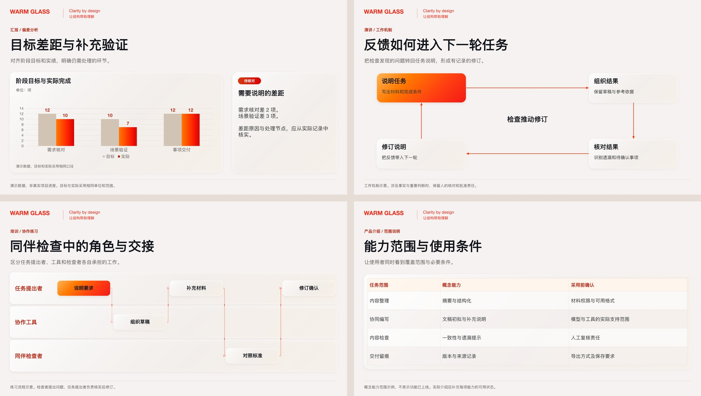

# Warm Glass PPT

暖白、红橙渐变与玻璃层次的可编辑 PPT 生成技能，适用于中文或中英双语的**汇报、演讲、培训、产品介绍**。

它包含可安装的 Agent Skill、叙事与设计规范，以及能离线运行的 PPTX / HTML 生成器。无需 API Key。图像生成能力是可选项。

开发版 `1.3.0-alpha.2` 采用**内容驱动的自由构图**，新增可执行的内容关系检查、实际 PPTX 渲染与当前文件审阅记录。先明确听众、目标和逐页判断，再安排原生对象；固定的是颜色、字体与材质，而不是整页骨架。品牌显式输入，默认不带示例 Logo 或 slogan。[内容策划](skills/warm-glass-ppt/references/content-planning.md) · [自由构图格式](skills/warm-glass-ppt/references/composition.md) · [审阅流程](skills/warm-glass-ppt/references/review.md) · [技能对标](docs/PPT_SKILL_BENCHMARK.md)。

精简技能包只含运行代码、规范、视觉变量和 JSON 样例，不带预生成 PPTX、截图画廊、插画、字体或依赖缓存。按需生成可编辑成品；旧版插画与兼容示例单独留在仓库的 `examples/legacy/`，不进入安装包。

[下载 1.3.0-alpha.2 精简技能包与校验文件](https://github.com/TPanic98/warm-glass-ppt-skill/releases/tag/v1.3.0-alpha.2)。这是开发预发布版，未完成 WorkBuddy 盲测或 WPS 实机交互。

`1.2.0-rc.1` 预发布版包含 **24 个通用组件、四类用途各 6 页样例**。已完成独立安装、离线生成、48 页实际渲染与 LibreOffice 打开另存测试。Microsoft PowerPoint 实机交互尚未验证，字体未嵌入，详见[测试记录](docs/TEST_REPORT.md)。[下载预发布包](https://github.com/TPanic98/warm-glass-ppt-skill/releases/tag/v1.2.0-rc.1)。

## 四类用途

| 用途 | 叙事重点 | 输入模式 | 示例 |
| --- | --- | --- | --- |
| 汇报 | 结论与进展、证据与偏差、风险与待决策事项 | `report` | [馆藏项目评审：资源取舍与并行计划](skills/warm-glass-ppt/examples/compose/report.json) |
| 演讲 | 核心观点、解释与案例、面向听众的启示 | `talk` | [结果与证据：问题与解释](skills/warm-glass-ppt/examples/compose/talk.json) |
| 培训 | 学习目标、概念与示例、练习与评估 | `training` | [含糊请求：前后对照与练习](skills/warm-glass-ppt/examples/compose/training.json) |
| 产品介绍 | 目标用户、场景与价值、能力证据与采用条件 | `product` | [巡检协作：任务闭环与采用边界](skills/warm-glass-ppt/examples/compose/product.json) |

四类用途共用视觉规范，不限制演讲者职级或所在行业。上述材料均为虚构回归用例，采用不同内容与页结构，不是把同一个文件只改 `mode`。可用 `npm run demo:content:report` 等四个命令生成到 `dist/content/`。这些页数不是用户任务的默认页数。路线图、架构图等属于不同用途均可采用的页面构图。`mode` 记录叙事意图；离线生成器排版已有文案，不会自动策划或补造事实。

以下为 1.2 参考资产，不是本轮重新生成的开发版效果：



[1.2 旧版成品与画廊归档](https://github.com/TPanic98/warm-glass-ppt-skill/releases/tag/v1.2.0-rc.1) · [24 个组件的生成源稿](skills/warm-glass-ppt/examples/ui/components.json) · [组件参数清单](skills/warm-glass-ppt/assets/components.json)

## 快速开始

需要 Node.js 20.9 或以上版本：

```bash
git clone --depth 1 https://github.com/TPanic98/warm-glass-ppt-skill.git
cd warm-glass-ppt-skill
npm ci --omit=optional
npm run demo
```

打开 `dist/compose/preview.html` 查看三种内容关系的设计示例，打开同目录的 `deck.pptx` 编辑。它不是所有新任务必须沿用的三页模板。`npm run demo:components` 可生成 24 页可编辑组件目录。四类六页兼容样例也保留 JSON，可按需生成；旧版成品与 48 页画廊从当前文件树移除，仍可从 1.2 发布归档恢复。

HTML 和 PPTX 共用布局数据，但不同应用的字体、阴影与换行可能不同。正式交付前需要检查实际 PPTX 渲染。生成器提供估算文字边界与画布检查，不会据此宣称已通过 PowerPoint 检查。

## 安装为技能

```bash
npm run install:skill
```

默认安装到 `~/.codex/skills/warm-glass-ppt`；`CODEX_HOME` 已设置时，使用其中的 `skills` 目录。安装器与 ZIP 打包器共用文件清单，复制必要源码及独立锁文件，再运行 `npm ci --omit=optional --ignore-scripts`。已存在同名目录时停止，不覆盖个人修改。依赖仍需另行安装，不计入技能 ZIP 的体积；生成和原图提取不需要可选 `sharp`，明确需要裁切时才在技能目录运行 `npm ci --include=optional`。

其他支持 Agent Skills 的工具可以使用同一个技能目录。例如安装到自选目录：

```bash
node scripts/install-skill.mjs --dest /your/agent/skills/warm-glass-ppt
```

安装后在支持技能的工具中调用：

```text
使用 $warm-glass-ppt，把我的材料整理成一套项目汇报 PPT，用于阶段评审。
先明确逐页职责，再统一暖白红橙玻璃风格，保留文字与关键图形可编辑。
```

## 自己生成 PPT

先根据实际材料写逐页意图和关系，再按[自由构图格式](skills/warm-glass-ppt/references/composition.md)编写 `warm-glass-compose/v1` 输入。新稿的默认路径不再是复制六页 JSON。然后运行：

```bash
node skills/warm-glass-ppt/scripts/build-ui.mjs my-brief.json --out output/my-deck
```

原有 `warm-glass-ui/v2` 输入继续受支持。只有用户明确选择旧模板，或某个局部组件确实适合时，才复用它的几何；`demo:report`、`demo:talk`、`demo:training`、`demo:product` 是旧组件格式的结构示例。

输出包括可编辑文稿、离线预览、布局数据和检查记录。文件已存在时会停止；确实要重新生成同一目录时添加 `--force`。所有图片采用本地 PNG/JPEG 或随包资产，构建过程不请求远程图片服务。

可选的 `context` 与 `sources` 记录听众目标和内容依据；页级 `claims` 区分实际、计划、示例、假设和待核实内容，并引用可见状态文字。`relations` 能检查声明的箭头方向、包含边界和共享刻度对齐。这些检查不替代事实核验或视觉判断。

## 检查实际 PPTX，而非仅看 HTML

安装 LibreOffice 和 Poppler 后，从技能目录运行：

```bash
node scripts/render-pptx.mjs output/my-deck --out output/my-deck/renders
node scripts/review.mjs init output/my-deck --render-manifest output/my-deck/renders/render.json
# 查看每页 PNG，并在 review.json 记录内容、设计和逐页审阅意见
node scripts/review.mjs verify output/my-deck
```

审阅记录初始全部待检查，不自动通过。修改输入、原始图片、场景、PPTX、生成实现或渲染后，旧记录失效。核验成功表示当前记录完整，不等于机器证明设计完美。未进行 WPS/PowerPoint 交互时保留 `not-tested`；缺少渲染工具时明确披露，不伪报通过。也可接入宿主的实际 PPTX 渲染器，详见[审阅格式与边界](skills/warm-glass-ppt/references/review.md)。

生成前选择本机和交付端可用的中文字体。检测到字体替换时渲染默认停止；确实接受替换时可显式允许，不能把替换后的效果冒称原字体保真。隔离的 Office 程序还可能需要进程内字体配置；正确提取出中文文本不代表画面没有方框。参见上述审阅文档的字体说明。

组件按关系组织：标题与结论、玻璃容器与定位节点、指标与比较、流程与路线图、嵌套与架构、证据与责任表，以及目录、趋势、目标实绩、二维矩阵、闭环、泳道、输入输出、能力覆盖表、案例、答疑、转场和收束。详细参数与容量见[组件说明](skills/warm-glass-ppt/references/ui-components.md)。支持在一页组合多个组件，不是用截图充当素材。

图表保留原生数据与嵌入式工作簿，表格保留单元格、行列与边框。组件的文字和形状按实例分组，图表、表格和附着连接线保持独立，修改节点后需复核连线路由。字体未嵌入；安装一致字体后仍需检查实际应用的排版。

旧版 11 类简易版式继续通过 `scripts/build.mjs` 使用；完整仓库内的 `npm run demo:legacy` 使用 `examples/legacy/` 生成兼容示例。新旧输入分别采用 1672×941 和 1600×900 画布，不混用坐标。生成器不宣称能自动编辑任意现有 PPTX。

## 可选：检查参考 PPT 中的图像

```bash
node skills/warm-glass-ppt/scripts/inspect-pptx.mjs reference.pptx
node skills/warm-glass-ppt/scripts/extract-assets.mjs reference.pptx --out extracted
```

这不是组件库的制作方式。先检查源文件是不是图片封装；若整页只有一张图，提取结果就是位图，不能恢复原始文字或矢量。仅在用户要求提取图片素材时使用裁切，并记录来源和像素范围。不要将裁切图标成可编辑组件。详见[素材说明](skills/warm-glass-ppt/references/assets.md)。

## 风格与编辑性

新组件库与四类用途样例均使用原生 PowerPoint 对象，没有图片组件。玻璃表面保留各渐变停靠点的不透明度，文字保持实色。PPT 使用透明填充、细边和软阴影近似玻璃，不包含实时背景模糊或真实折射。旧版示例中的可选玻璃插画是独立图片，不参与新组件实现。

参考 HTML 的六组渐变、暖白色板、玻璃材质和品牌保护区已转入[视觉规范](skills/warm-glass-ppt/references/visual-system.md)与设计变量。保留 1672×941 参考画布，按内容设计页内结构；用户提供品牌时保留其原始比例和位置。公开默认不注入包名、口号、机构标识或右上角样板页码。

设计变量来自参考材料的规范化提炼，属于视觉复现建议，不是任何银行的官方 VI。原始课件、业务数字、标识、付费字体与本地提取素材不随仓库发布。字体不嵌入：请在编辑与投屏设备安装一致的中文字体。[资产来源](docs/ASSETS.md)说明了可选旧插画与公开内容的范围。

## 维护与发布

```bash
npm test
npm run audit:public
npm run package:skill
```

测试覆盖新旧输入、自由构图、原始品牌、封面单一标题、图表表格、容量、内容引用与可见状态、关系断言、当前文件审阅及陈旧记录拒绝。安装器与打包器只收录清单内的文件，技能 ZIP 限 256 KiB、未压缩源码限 1 MiB，防止新增大素材误入。回执协议单测中的小 PNG 仅测试文件状态，不计作视觉验收。跨宿主陌生材料测试仍单独记录，见[任务与边界](docs/CONTENT_LED_EVALS.md)。打包命令仅生成本地 ZIP 和 SHA-256，不创建远程版本或上传文件。[旧版测试记录](docs/TEST_REPORT.md)及[发布说明](docs/RELEASE_REVIEW.md)保留当时的实际验证范围。

[alpha.2 验证记录](docs/CONTENT_LED_ALPHA2_TESTS.md)：28 项测试通过（含 3 项分发回归），四类材料 9 页实际渲染审阅通过，精简包独立安装通过；未完成 WorkBuddy 盲测或 WPS 实机交互。

## English quick start

For reports, talks, training and product introductions. Install Node.js 20.9+, shallow-clone this repository, run `npm ci --omit=optional` and `npm run demo`. Install the agent skill with `npm run install:skill`, then invoke `$warm-glass-ppt`. Use `report`, `talk`, `training` or `product` to record narrative intent. The offline generator produces native editable text, shapes and gradient-stop transparency plus a self-contained HTML design preview. It is reference-informed, unbranded and does not require an API key. Inspect the actual PPTX in your presentation application before delivery.

## License

New code, generic examples and documentation are released under MIT. Original reference decks and third-party brands are excluded. Dependency licenses and generated-artwork provenance are listed in [docs/ASSETS.md](docs/ASSETS.md).
