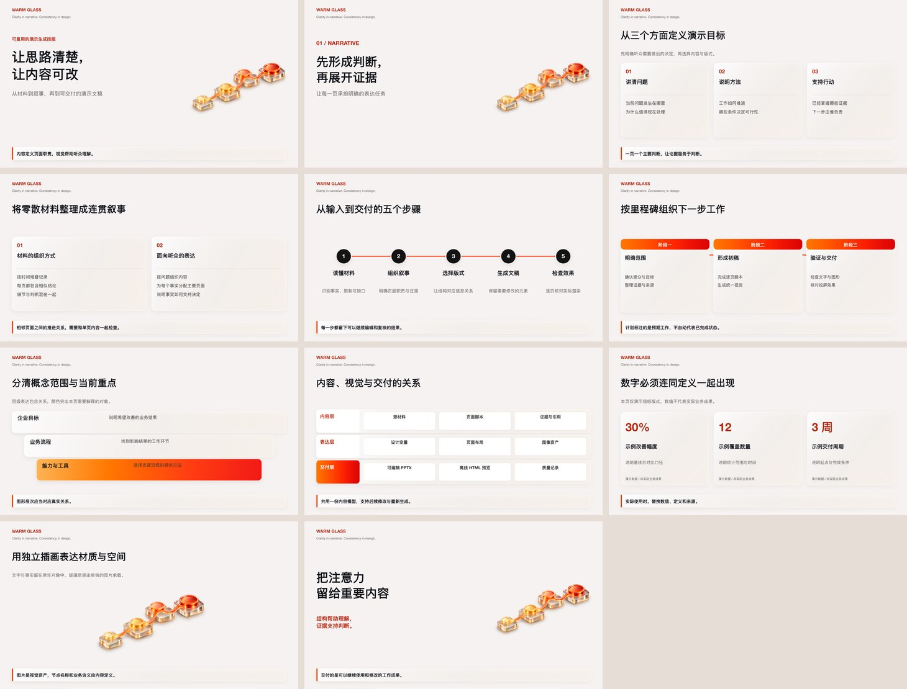

# Warm Glass PPT

暖白、红橙渐变与玻璃层次的可编辑 PPT 生成技能，适用于中文或中英双语的**汇报、演讲、培训、产品介绍**。

它包含可安装的 Agent Skill、叙事与设计规范，以及能离线运行的 PPTX / HTML 生成器。无需 API Key。图像生成能力是可选项。

## 四类用途

| 用途 | 叙事重点 | 输入模式 | 示例 |
| --- | --- | --- | --- |
| 汇报 | 结论与进展、证据与偏差、风险与待决策事项 | `report` | [阶段汇报](skills/warm-glass-ppt/examples/report.json) |
| 演讲 | 核心观点、解释与案例、面向听众的启示 | `talk` | [主题演讲](skills/warm-glass-ppt/examples/talk.json) |
| 培训 | 学习目标、概念与示例、练习与评估 | `training` | [协作培训](skills/warm-glass-ppt/examples/training.json) |
| 产品介绍 | 目标用户、场景与价值、能力证据与采用条件 | `product` | [产品介绍](skills/warm-glass-ppt/examples/product.json) |

四类用途共用视觉规范，不限制演讲者职级或所在行业。路线图、架构图等属于可用于不同用途的页面版式。`mode` 记录叙事意图；技能据此组织内容，离线生成器排版已有文案，不会自动改写或补造事实。



## 快速开始

需要 Node.js 20.9 或以上版本：

```bash
git clone https://github.com/TPanic98/warm-glass-ppt-skill.git
cd warm-glass-ppt-skill
npm ci
npm run demo
```

打开 `dist/showcase/preview.html` 查看设计预览，打开 `dist/showcase/deck.pptx` 编辑文稿。仓库中的 `docs/demo.pptx` 是现成示例，`docs/preview.html` 可直接离线打开。

HTML 和 PPTX 共用布局数据，但不同应用的字体、阴影与换行可能不同。正式交付前需要检查实际 PPTX 渲染。生成器提供估算文字边界与画布检查，不会据此宣称已通过 PowerPoint 检查。

## 安装为技能

```bash
npm run install:skill
```

默认安装到 `~/.codex/skills/warm-glass-ppt`；`CODEX_HOME` 已设置时，使用其中的 `skills` 目录。安装器完整复制技能与独立依赖锁文件，跳过 `node_modules`，并在安装目录运行 `npm ci`。已存在同名目录时停止，不覆盖个人修改。

其他支持 Agent Skills 的工具可以使用同一个技能目录。例如安装到自选目录：

```bash
node scripts/install-skill.mjs --dest /your/agent/skills/warm-glass-ppt
```

安装后在支持技能的工具中调用：

```text
使用 $warm-glass-ppt，把我的材料整理成一套项目汇报 PPT，用于阶段评审。
先明确逐页职责，再统一暖白红橙玻璃风格，保留文字与关键图形可编辑。
```

## 自己生成 PPT

按用途复制并修改对应示例，或使用涵盖全部 11 类版式的 `skills/warm-glass-ppt/examples/showcase.json`，然后运行：

```bash
node skills/warm-glass-ppt/scripts/build.mjs my-brief.json --out output/my-deck
```

也可运行 `npm run demo:report`、`npm run demo:talk`、`npm run demo:training`、`npm run demo:product`，分别生成四类结构示例。

输出包括可编辑文稿、离线预览、布局数据和检查记录。文件已存在时会停止；确实要重新生成同一目录时添加 `--force`。所有图片采用本地 PNG/JPEG 或随包资产，构建过程不请求远程图片服务。

支持 11 类页面：封面、章节、并列观点、比较、流程、路线图、层级、架构、指标、结语和图片。复杂数据图表或需要保持原始表格结构的任务，应使用原生图表/表格能力；本生成器不宣称能自动编辑任意现有 PPTX。

## 从参考 PPT 提取 UI 素材

```bash
node skills/warm-glass-ppt/scripts/inspect-pptx.mjs reference.pptx
node skills/warm-glass-ppt/scripts/extract-assets.mjs reference.pptx --out extracted
```

先检查源文件是不是图片封装。若整页只有一张图，提取结果就是原始位图，不能恢复成原始图标、文字或 SVG。需要局部素材时使用 `--regions crops.json --crops-only`，每个裁切都记录来源和像素范围，并生成图库。裁切不自动去底；详见 [素材说明](skills/warm-glass-ppt/references/assets.md)。

## 风格与编辑性

文字、关系图、卡片和渐变由原生 PowerPoint 对象生成；玻璃插画是独立图片。玻璃表面保留各渐变停靠点的透明度，文字保持实色。PPT 不支持直接复现 CSS 背景模糊，本包使用透明填充、细边和软阴影表达层次；HTML 另外保留背景模糊、接触阴影与内高光。需要真实折射与复杂 3D 时，使用独立图像资产承载质感。

参考 HTML 的六组渐变、暖白色板、玻璃材质和页眉边界已转入[视觉规范](skills/warm-glass-ppt/references/visual-system.md)与设计变量。源参考为 1672×941，离线布局规范化到 1600×900，默认不在右上角添加样板页码。仅迁移视觉语言，不复制原材料的品牌、课程名称或业务内容。

设计变量来自参考材料的规范化提炼，属于视觉复现建议，不是任何银行的官方 VI。原始课件、业务数字、标识、付费字体与本地提取素材不随仓库发布。字体不嵌入：请在编辑与投屏设备安装一致的中文字体。[资产来源](docs/ASSETS.md)说明了随包插画与公开内容的范围。

## 维护与发布

```bash
npm test
npm run audit:public
npm run package:skill
```

测试覆盖输入拒绝、文字溢出、原生对象、渐变、图像提取与防覆盖行为。`docs/github-actions-ci.yml` 提供在 Node.js 20 / 22 上运行同一套检查的配置；需要自动运行时，将它放到 `.github/workflows/ci.yml`。本次发布凭据没有 `workflow` 权限，因此仓库未启用该配置；本地测试与独立安装已验证。技能 ZIP、SHA-256 校验文件和发布 ZIP 在 `releases/` 生成，不包含原始参考文件或依赖目录。

## English quick start

For reports, talks, training and product introductions. Install Node.js 20.9+, clone this repository, run `npm ci` and `npm run demo`. Install the agent skill with `npm run install:skill`, then invoke `$warm-glass-ppt`. Use `report`, `talk`, `training` or `product` to record narrative intent. The offline generator produces native editable text, shapes and gradient-stop transparency plus a self-contained HTML design preview. It is reference-informed, unbranded and does not require an API key. Inspect the actual PPTX in your presentation application before delivery.

## License

New code, generic examples and documentation are released under MIT. Original reference decks and third-party brands are excluded. Dependency licenses and generated-artwork provenance are listed in [docs/ASSETS.md](docs/ASSETS.md).
